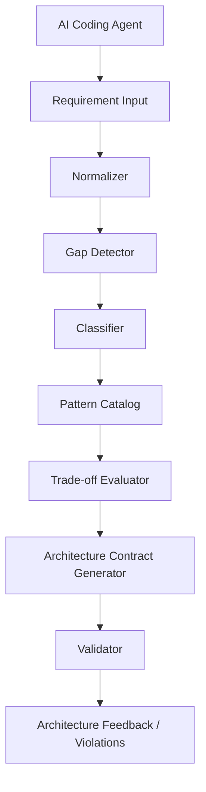

# ArchIntel: AI System Design Intelligence Layer

ArchIntel is a Go-based architectural decision engine for AI coding agents and engineering teams. It turns natural-language product requirements into a structured, explainable architecture recommendation, helping avoid common anti-patterns such as premature microservice adoption, weak transaction design, poor queue sizing, and missing idempotency or consistency rules.

The system operates as a decision pipeline:
- normalize raw requirements,
- detect ambiguities and missing facts,
- classify workload traits,
- retrieve relevant architectural patterns,
- score and compare alternatives,
- generate a machine-readable architecture contract,
- validate proposed implementations against that contract.

This repo is intentionally centered on logic, contracts, and evaluation rather than UI generation or application code generation.

## Why this project exists

AI agents are excellent at producing boilerplate, but they often make weak architectural choices when requirements are underspecified. ArchIntel provides a deterministic layer that:

- converts requirements into normalized architecture signals,
- distinguishes explicit user intent from inferred assumptions,
- recommends the simplest sufficient topology,
- validates implementations against architectural constraints,
- exposes the decision pipeline through MCP and HTTP interfaces.

## Core capabilities

- Requirement normalization and gap analysis
- Workload trait classification
- Heuristic rule-based classification with LAYA fallback support
- Structured architectural pattern catalog
- Multi-criteria trade-off evaluation
- Architecture contract generation
- Implementation compliance validation
- MCP server tooling for agent integration
- Lightweight HTTP API for health checks and recommendation endpoints

## Stack

- Language: Go
- Module: `github.com/sdskill/archintel`
- Version: Go 1.27.2
- Runtime model: library + service-oriented engine
- Integration surfaces:
  - Model Context Protocol (MCP)
  - HTTP REST endpoints

## High-level architecture



The actual Go package structure follows this pipeline closely:

- `pkg/model`: domain models and schema contracts
- `pkg/normalizer`: requirement parsing and gap detection
- `pkg/classifier`: workload classification
- `pkg/knowledge`: architectural patterns and anti-patterns
- `pkg/evaluator`: alternative analysis and decisions
- `pkg/contract`: contract generation
- `pkg/validator`: implementation compliance checks
- `pkg/engine`: orchestration of the full pipeline
- `pkg/mcpserver`: MCP server
- `pkg/server`: HTTP API endpoints

## Repository layout

```text
ArchIntel-A-System-Desing-Skill-For-Ai-agents/
├── .agents/
├── .gitignore
├── AGENTS.md
├── context.md
├── completedTask.md
├── go.mod
├── rules.md
├── tasks.md
├── pkg/
│   ├── classifier/
│   │   ├── classifier.go
│   │   ├── heuristic.go
│   │   ├── heuristic_test.go
│   │   ├── laya_adapter.go
│   │   └── laya_adapter_test.go
│   ├── contract/
│   │   ├── generator.go
│   │   └── generator_test.go
│   ├── engine/
│   │   ├── engine.go
│   │   └── engine_test.go
│   ├── evaluator/
│   │   ├── evaluator.go
│   │   ├── evaluator_test.go
│   │   ├── rejections.go
│   │   ├── rejections_test.go
│   │   └── tradeoffs.go
│   ├── knowledge/
│   │   ├── antipatterns.go
│   │   ├── antipatterns_test.go
│   │   ├── catalog.go
│   │   ├── patterns.go
│   │   └── patterns_test.go
│   ├── mcpserver/
│   │   ├── server.go
│   │   ├── server_test.go
│   │   └── tools.go
│   ├── model/
│   │   ├── classification.go
│   │   ├── classification_test.go
│   │   ├── contract.go
│   │   ├── contract_test.go
│   │   ├── doc.go
│   │   ├── provenance.go
│   │   ├── requirements.go
│   │   └── requirements_test.go
│   ├── normalizer/
│   │   ├── gaps.go
│   │   ├── gaps_test.go
│   │   ├── normalizer.go
│   │   └── normalizer_test.go
│   ├── server/
│   │   ├── daemon_test.go
│   │   ├── handlers.go
│   │   ├── http.go
│   │   └── http_test.go
│   └── validator/
│       ├── rules.go
│       ├── validator.go
│       └── validator_test.go
├── tests/
│   ├── e2e/
│   └── fixtures/
└── README.md
```

## How the engine works

The engine is orchestrated through `pkg/engine/engine.go` and exposes a small set of core operations:

- `AnalyzeRequirements(...)`
- `ClassifyWorkload(...)`
- `RecommendArchitecture(...)`
- `EvaluateTradeoffs(...)`
- `ValidateArchitecture(...)`

These methods work together to produce a recommendation from raw project description to contract-backed validation.

### Stage 1: Normalize requirements

The model layer defines `RawRequirement` and `NormalizedRequirements`, including:

- traffic and load expectations,
- data profile and ACID requirements,
- latency targets,
- deployment and compliance constraints,
- business invariants and assumptions.

### Stage 2: Detect gaps

The normalizer and gap detector identify what is missing or unclear, then attach explicit assumptions and unresolved questions so the architecture does not stall on incomplete data.

### Stage 3: Classify workload

The classifier determines workload dimensions such as:

- transaction-heavy,
- read-heavy,
- write-heavy,
- latency-sensitive,
- background-processing-intensive,
- consistency-sensitive,
- resource-constrained.

This is implemented with rule-based heuristics and a LAYA adapter.

### Stage 4: Retrieve patterns

The knowledge layer stores curated architectural patterns and anti-patterns, including:

- modular monoliths,
- transactional outbox patterns,
- database-backed job queues,
- cache-aside patterns,
- optimistic/pessimistic concurrency patterns,
- anti-patterns such as distributed complexity for simple systems.

### Stage 5: Evaluate trade-offs

The evaluator ranks candidate architectures based on:

- consistency,
- latency,
- complexity,
- operational cost,
- blast radius,
- failure modes.

This is explicitly designed to prefer the simplest sufficient architecture unless the problem genuinely requires more complexity.

### Stage 6: Generate a contract

The contract generator assembles a machine-readable architecture contract that captures:

- topology,
- component boundaries,
- data rules,
- queue rules,
- locking strategy,
- validation criteria,
- implementation constraints.

### Stage 7: Validate implementation

The validator checks whether proposed structures or code patterns comply with the generated contract, surfacing violations such as:

- database access in HTTP handlers,
- unsafe locking,
- missing idempotency protections,
- blocked external calls inside transactions,
- worker patterns that ignore queue/backpressure constraints.

## MCP tooling

The repo includes an MCP server under `pkg/mcpserver` with tool entry points such as:

- `analyze_requirements`
- `classify_workload`
- `recommend_architecture`
- `evaluate_tradeoffs`
- `validate_architecture`

This makes ArchIntel usable as an agent-facing service for architectural scoring and validation.

## HTTP API

The HTTP server under `pkg/server` exposes:

- `GET /health`
- `POST /api/v1/recommend`
- `POST /api/v1/validate`

This enables local or embedded experimentation without requiring an MCP client.

## Getting started

### Prerequisites

- Go 1.27.2 or newer

### Install dependencies

```bash
git clone https://github.com/Typecaster12/ArchIntel-A-System-Desing-Skill-For-Ai-agents.git
cd ArchIntel-A-System-Desing-Skill-For-Ai-agents
go mod download
```

### Run tests

```bash
go test ./...
```

### Example programmatic usage

```go
package main

import (
	"context"
	"fmt"

	"github.com/sdskill/archintel/pkg/engine"
	"github.com/sdskill/archintel/pkg/model"
)

func main() {
	ctx := context.Background()

	eng := engine.NewEngine(engine.EngineOptions{})

	res, err := eng.RecommendArchitecture(ctx, model.RawRequirement{
		Prompt: "Build a payment processing system for a retail checkout flow with strict consistency, idempotent requests, and moderate traffic.",
		PreferredStack: []string{"Go", "PostgreSQL"},
		StatedTraffic: "5k DAU",
	})
	if err != nil {
		panic(err)
	}

	fmt.Println(res.ExecutiveSummary)
}
```

## Design philosophy

This repository follows a strict architectural stance:

- requirements before architecture,
- classification before selection,
- simplicity by default,
- explainability over black-box decisions,
- deterministic validation over vague generative advice,
- no unnecessary distributed complexity unless justified by workload and constraints.

This makes it particularly useful for AI-agent architecture supervision and design review.

## Project status

This repository is a Go-based architectural intelligence layer and design skill prototype. The codebase already includes the major pipeline components and test coverage for models, validation, evaluator logic, and protocol adapters. It is structured as a reusable engine with agent-friendly interfaces rather than a general-purpose application.

## License

This repository does not currently advertise a license file in the repository snapshot reviewed here. If you plan to distribute or reuse it publicly, confirm the project’s legal licensing terms before publishing or integrating it into a commercial system.
