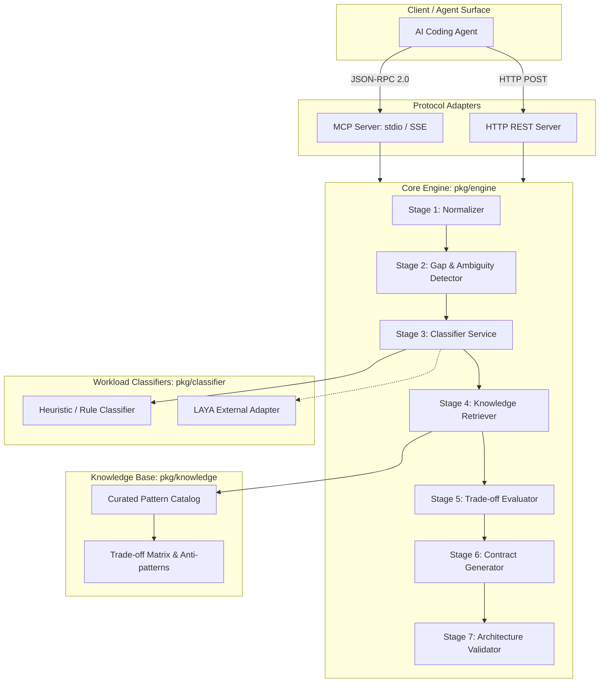

# AI System Design Intelligence Layer — Architecture & System Context

## 1. Executive Summary & Vision

The **AI System Design Intelligence Layer** (`sdskill` / `archintel`) is a production-minded, agent-first architectural decision engine designed to run as a companion service for AI coding agents (such as Claude Code, Roo Code, Cursor, Windsurf, Antigravity) and vibe-coding workflows.

### 1.1 The Problem It Solves
AI coding agents are proficient at generating boilerplate code, but frequently make poor, boilerplate-driven architectural choices:
- Blindly applying Route-Controller-Service patterns to batch jobs or simple CLI tools.
- Placing business logic inside controllers or database hooks.
- Processing high-latency or failure-prone operations synchronously in HTTP request cycles.
- Overlooking database transaction boundaries, race conditions, optimistic vs. pessimistic locking, and idempotency.
- Introducing unnecessary distributed infrastructure (Kafka, RabbitMQ, Redis, Kubernetes, microservices) for single-instance, low-throughput projects.
- Ignoring backpressure, bounded queues, dead-letter recovery, retries with jitter, and connection pool starvation.
- Fabricating theoretical maximum scalability at the expense of operational simplicity and maintainability.

### 1.2 Core Role
This system **does not write application code** and **does not provide a graphical UI**. It acts as an **architectural oracle and validator**:
1. Receives normalized requirements from an AI coding agent.
2. Identifies ambiguities and material unknowns.
3. Classifies workload characteristics across multiple dimensions.
4. Retrieves structured, verified architectural patterns and trade-offs.
5. Deterministically evaluates architectural alternatives.
6. Emits an immutable, machine-readable **Architecture Contract** (JSON schema).
7. Validates proposed code structures and implementation decisions against the contract.

```
+-------------------------------------------------------------------------+
|                           AI Coding Agent                               |
|            (e.g., Cursor, Claude Code, Antigravity, Roo Code)           |
+-------------------------------------------------------------------------+
       |                                              ^
       | 1. Requirements / Probing                    | 6. Architecture Contract
       |    Validation Requests                       |    & Violation Reports
       v                                              |
+-------------------------------------------------------------------------+
|                  Integration Layer (MCP / HTTP)                         |
|  - MCP Server (stdio / SSE JSON-RPC)                                    |
|  - HTTP REST API (debug, health, local inspection)                      |
+-------------------------------------------------------------------------+
       |                                              ^
       v                                              |
+-------------------------------------------------------------------------+
|                       Core Decision Pipeline                            |
|                                                                         |
|  Stage 1: Requirement Normalization & Parsing                           |
|  Stage 2: Ambiguity & Missing Information Discovery                     |
|  Stage 3: Workload Classification (Rule-based & LAYA Adapter)           |
|  Stage 4: Structured Architectural Knowledge Retrieval                  |
|  Stage 5: Multi-Criteria Trade-off Evaluation Engine                    |
|  Stage 6: Architecture Contract Generation                              |
|  Stage 7: Implementation & Structural Validation Engine                 |
+-------------------------------------------------------------------------+
```

---

## 2. Architectural Philosophy & Core Principles

1. **Requirements Before Architecture**: Technology stack preferences (e.g., "we want Go + PostgreSQL") never dictate architecture alone. Workload profiles, traffic volumes, latency SLAs, consistency needs, and failure recovery govern pattern selection.
2. **Classification Before Selection**: Classify multi-dimensional workload traits (e.g., `write-heavy`, `consistency-sensitive`, `bursty-traffic`) prior to picking design topologies.
3. **Simplicity by Default**: A modular monolith with standard transactional SQL is preferred over microservices with distributed message brokers unless scale, independent deployment, or organizational boundaries strictly mandate distribution.
4. **Explainable Recommendations**: Every chosen pattern must document the requirement it addresses, alternatives evaluated, trade-offs accepted, assumptions made, failure modes, and migration triggers.
5. **Deterministic Rules Over Generative Hallucinations**: Core architectural boundaries, concurrency limits, and database transaction models are verified with deterministic rules. LLM/classifier assistance is bounded to classification and synthesis.
6. **No Mocking Deception**: Integrations (such as LAYA inference) use explicit interfaces. If an external model runtime is offline or unverified, the system transparently falls back to heuristic engines and clearly logs that state.

---

## 3. High-Level System Architecture



---

## 4. The 7-Stage Core Processing Workflow

### Stage 1: Receive and Normalize Requirements
- **Inputs**: Raw prompt string, optional structured inputs (expected RPS, user count, persistence preferences, SLA, compliance).
- **Output**: `NormalizedRequirements` struct.
- **Responsibilities**:
  - Distinguishes explicitly stated facts from inferred traits.
  - Normalizes units (e.g., "100k daily active users" -> ~1.15 avg req/s, ~10-20 peak req/s).
  - Categorizes functional domain (e.g., e-commerce, financial ledger, IoT telemetry, CRUD, notification service).

### Stage 2: Identify Missing Information & Gaps
- **Responsibilities**:
  - Scans for critical architectural omissions (e.g., unspecified data volume, unknown consistency requirements for payment flows).
  - Emits non-blocking clarifying questions with sensible, documented defaults.
  - Guarantees analysis can proceed even under uncertainty by documenting assumed parameters.

### Stage 3: Classify the Workload
- **Responsibilities**:
  - Computes multi-label workload attributes:
    - `TransactionHeavy`: High ACID needs, financial or inventory ledger operations.
    - `ReadHeavy`: Cache-friendly, search-intensive, read-to-write ratio > 10:1.
    - `WriteHeavy`: Append-only, time-series, telemetry, write-to-read ratio > 5:1.
    - `LatencySensitive`: Strict p99 < 50ms deadlines.
    - `BackgroundProcessingIntensive`: Long-running async exports, conversions, batch syncs.
    - `ConsistencySensitive`: Zero tolerance for phantom reads or double-spends.
    - `ResourceConstrained`: Low memory/CPU constraints or serverless execution limits.
  - Evaluates via `RuleBasedClassifier` and delegates to `LayaClassifier` when active.

### Stage 4: Retrieve Architectural Knowledge
- **Responsibilities**:
  - Pulls patterns from an embedded, typed Go catalog (in-memory, versioned, zero external vector DB overhead).
  - Pattern examples: Modular Monolith, Outbox Worker, CQRS Lite, Database-Backed Job Queue, Stream Processing Pipeline, Optimistic Concurrency Control.
  - Anti-patterns matched against detected workload traits (e.g., "Distributed 2PC across microservices for simple e-commerce").

### Stage 5: Evaluate Architectural Alternatives & Trade-offs
- **Responsibilities**:
  - Ranks viable candidates against multidimensional criteria:
    - Consistency, Latency, Operational Cost, Cognitive Complexity, Failure Blast Radius.
  - Generates explicit rejection rationales for discarded patterns.

### Stage 6: Produce the Architecture Contract
- **Responsibilities**:
  - Produces an immutable, schema-validated JSON contract:
    - `SystemTopology`: Monolith, Modular Monolith, Service-oriented.
    - `ComponentManifest`: Boundaries, inputs, outputs, persistence models.
    - `DataAndTransactionRules`: Isolation level, concurrency locking strategy, idempotency key pattern.
    - `AsyncAndQueueRules`: Queue bounds, retry policy with jitter, dead-letter strategy, worker concurrency.
    - `ImplementationConstraints`: Explicit "Do" and "Do Not" guidelines for the coding agent.
    - `ValidationCriteria`: Statically verifiable rules (e.g., "No database calls in HTTP handler").

### Stage 7: Guide Implementation and Validate Compliance
- **Responsibilities**:
  - Endpoints/tools to evaluate agent-submitted code snippets, directory layouts, and design choices against the active contract.
  - Flags violations (e.g., unindexed foreign keys, synchronous external HTTP calls in payment transactions, unbuffered goroutines without worker pools).

---

## 5. Deep-Dive: Transaction-Heavy and Queue-Intensive Systems

A key failure mode of AI coding agents is hallucinating simplistic queues or ignoring distributed data anomalies. The engine provides specific rule sets for:

### 5.1 Concurrency & Consistency Models
- **Optimistic Locking**: Mandated for low-contention entities via version tags (`version INT` / `updated_at`).
- **Pessimistic Locking (`SELECT FOR UPDATE`)**: Required for high-contention, low-inventory balance deductions where retries would degrade under heavy load.
- **Idempotency Keys**: Enforced on all mutating transactional endpoints (`idempotency_keys` table with status `PROCESSING`, `COMPLETED`, TTL, and response cache).
- **Transactional Outbox Pattern**: Required when a database state change must reliably trigger an external message/event, preventing dual-write split-brain bugs.

### 5.2 Queue & Worker Architecture
- **Scale-Appropriate Queues**:
  - If RPS < 500 & database is PostgreSQL: Recommend PostgreSQL `FOR UPDATE SKIP LOCKED` job queue before recommending Kafka or RabbitMQ.
  - If high throughput / fan-out: Recommend dedicated message broker with bounded consumer groups.
- **Bounded Resources**: Worker pools must define explicit concurrency limits, preventing DB connection pool exhaustion.
- **Backpressure & Retries**: Exponential backoff with randomized jitter, maximum retry budgets, and mandatory Dead-Letter Queues (DLQ) with alert hooks.
- **No False Guarantees**: Rejects claims of "exactly-once delivery"; enforces "at-least-once with idempotent consumer".

---

## 6. LAYA & Protocol Integration Strategy

### 6.1 LAYA Classification Integration
- **Background**: LAYA is a non-autoregressive decision model family (~322M-421M parameters, based on ModernBERT) designed by Convai / Layer3 for sub-50ms single-pass classification and scoring.
- **Strategy**:
  1. The core engine defines a clean Go interface:
     ```go
     type Classifier interface {
         Classify(ctx context.Context, req *NormalizedRequirements) (*ClassificationResult, error)
     }
     ```
  2. `RuleBasedClassifier`: Built-in deterministic heuristic classifier (zero runtime dependencies, immediate, fully unit-tested).
  3. `LayaHTTPClassifier`: Client adapter connecting to a locally hosted or containerized LAYA inference endpoint (`POST /v1/classify`). If the service is unreachable or unconfigured, falls back gracefully to `RuleBasedClassifier` with explicit metadata flags.

### 6.2 Agent Protocol: Model Context Protocol (MCP)
- The service acts as an MCP Server exposing tools:
  - `analyze_requirements`: Ingests project prompt, produces normalized requirements and gap analysis.
  - `classify_workload`: Returns workload taxonomy and confidence scores.
  - `recommend_architecture`: Executes full pipeline, returning the Architecture Contract and rationale.
  - `evaluate_tradeoffs`: Compares two or more specific architectural alternatives.
  - `validate_architecture`: Checks proposed file structure or code snippet against the active contract.
- Supports both **stdio transport** (for direct process invocation by AI agents) and **SSE / HTTP transport** (for network-accessible services).

---

## 7. Directory Structure & Component Boundaries

```
SdSkill/
├── cmd/
│   ├── archintel/               # Main CLI / Service Entrypoint
│   │   └── main.go
│   └── archintel-mcp/           # Dedicated MCP Server binary (stdio)
│       └── main.go
├── pkg/
│   ├── model/                   # Domain entities, schemas, and contract models
│   │   ├── requirements.go
│   │   ├── classification.go
│   │   ├── contract.go
│   │   ├── evaluation.go
│   │   └── validation.go
│   ├── normalizer/              # Stage 1 & 2: Parsing, normalizing, gap detection
│   │   ├── normalizer.go
│   │   └── gaps.go
│   ├── classifier/              # Stage 3: Heuristic & LAYA adapters
│   │   ├── classifier.go
│   │   ├── heuristic.go
│   │   └── laya_adapter.go
│   ├── knowledge/               # Stage 4: Embedded architectural patterns & catalog
│   │   ├── catalog.go
│   │   └── patterns.go
│   ├── evaluator/               # Stage 5: Multi-criteria decision engine
│   │   ├── evaluator.go
│   │   └── tradeoffs.go
│   ├── contract/                # Stage 6: Contract generation & JSON serialization
│   │   ├── generator.go
│   │   └── schema.go
│   ├── validator/               # Stage 7: Implementation compliance validator
│   │   ├── validator.go
│   │   └── rules.go
│   ├── engine/                  # Orchestrator binding stages 1-7 together
│   │   └── engine.go
│   ├── mcp/                     # MCP protocol server adapter
│   │   ├── server.go
│   │   └── tools.go
│   └── server/                  # HTTP REST server (health, debug, evaluation)
│       ├── http.go
│       └── handlers.go
├── tests/
│   ├── e2e/                     # End-to-end pipeline evaluation tests
│   └── fixtures/                # Real-world benchmark project requirements
├── go.mod
├── context.md
├── tasks.md
├── completedTask.md
└── rules.md
```

---

## 8. Non-Goals & Strict Boundaries

1. **No UI or Graphical Dashboards**: Zero HTML, React, Vite, or web frontends.
2. **No Generic Chatbotting**: The system does not converse about open-ended topics; it returns structured architectural advice and contracts.
3. **No Code Generation**: It does not write the business logic or Go/Python/JS application code; the external AI coding agent does that under the constraints of the contract.
4. **No Unbounded Distributed Tech**: It does not suggest microservices, Kafka, or Kubernetes unless requirements genuinely necessitate them.
5. **No Hallucinated Benchmarks**: All trade-offs and confidence scores reflect deterministic evaluations or actual classifier outputs.
